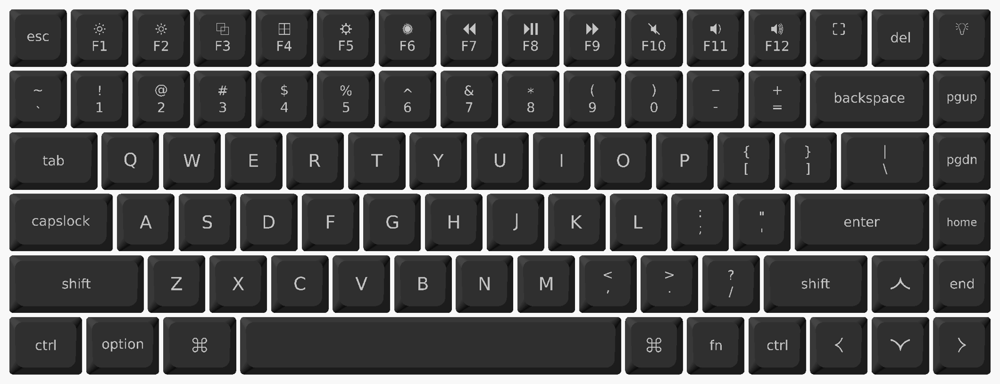
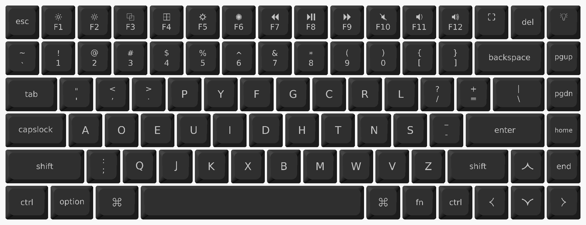
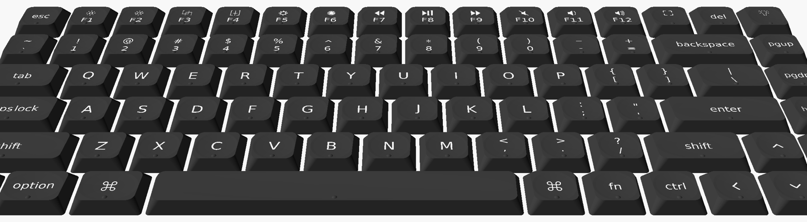
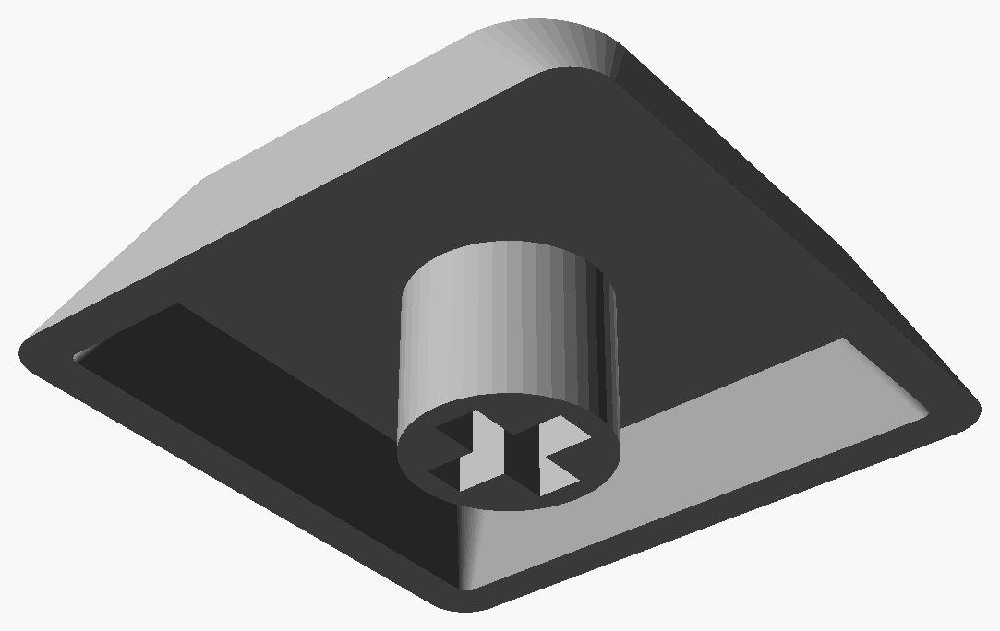

# Keychron K3 Ultra keycaps

3D-printable keycaps for the [Keychron K3 Ultra 8K](https://www.keychron.com/products/keychron-k3-ultra-8k-wireless-custom-mechanical-keyboard).

## Keys

- [Flat](keys/flat)
- [Flat, with homing bump](keys/flat-bump)
- [Dished](keys/dished)
- [Dished, with homing bump](keys/dished-bump)

One file per key, named by row and key: `r3-f.3mf` is F. Row 0 is the Fn row.

### QWERTY (macOS)

### QWERTY (Windows)

### Dvorak (macOS)

### Dished, with homing bumps

### Underside

## Printing

Each file has two parts: the cap and the legend. Give each its own filament. A printer with an MMU prints both in one job.

Print backspace first. The stabilizer spacing on backspace, enter, left shift, and space is not measured on a K3 Ultra.

## Homing bump

A drop of resin is smoother than a printed bump. Print a key without a bump, add a tiny drop of resin with a toothpick, and let it cure.

## Fits

- [K3 Ultra 8K](https://www.keychron.com/products/keychron-k3-ultra-8k-wireless-custom-mechanical-keyboard)
- Untested: [K3 Pro](https://www.keychron.com/products/keychron-k3-pro-qmk-via-wireless-custom-mechanical-keyboard), [K3 Max](https://www.keychron.com/products/keychron-k3-max-qmk-via-wireless-custom-mechanical-keyboard) (Keychron sells them the [same keycaps](https://www.keychron.com/products/black-transparent-low-profile-lsa-full-set-keycap-set))
- Does not fit the original [K3](https://www.keychron.com/products/keychron-k3-wireless-mechanical-keyboard)
