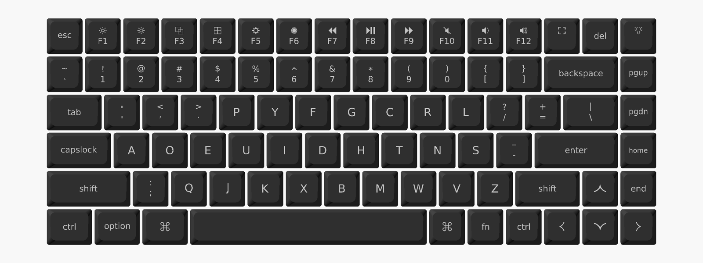
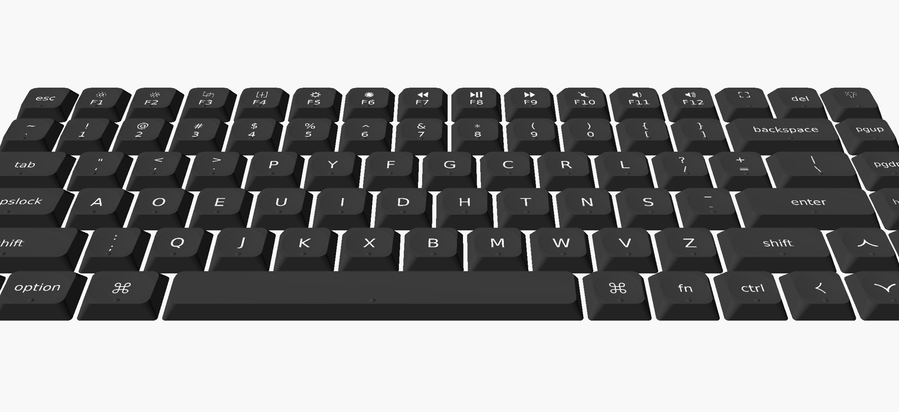

# Keychron K3 Ultra keycaps

Printable LSA-style keycaps for the Keychron K3 Ultra 8K (ANSI, 84 keys), with Dvorak legends. Each cap has a separate legend part for two-color printing.




## Compatibility

MX-style cross stem, stabilizer stems in line with the switch stem. Keychron sells one low-profile keycap set for the K3 Ultra, K3 Pro and K3 Max, so these should fit all three. They do not fit the original K3 (v1–v5), whose stabilizer stems are offset.

## Files

`keys/<variant>/r<row>-<key>.3mf`, one key per file. Rows run 0 (Fn row) to 5 (space bar row). Key ids are in [`layout.py`](layout.py).

| Variant | Top | Homing bump |
|---|---|---|
| `flat` | flat | no |
| `flat-bump` | flat | yes |
| `dished` | spherical dish, 0.4 mm | no |
| `dished-bump` | spherical dish, 0.4 mm | yes |

Each 3MF holds one object with two parts: `cap` and `inlay` (the legend). Assign a filament to each. Blank keys (space bar) have no inlay. Caps are exported in print orientation, stem on the bed.

## Homing ridge

The bump is a spherical dot 10% larger than stock: 1.65 mm wide, 0.33 mm tall (stock 1.5 × 0.3 mm), 1.6 mm from the front edge.

Preferred: print a cap without a bump and put a tiny drop of resin on it with a toothpick and let it cure. A printer cannot make a bump that smooth.

## Dimensions

| | |
|---|---|
| Key pitch | 19.05 mm |
| 1u skirt | 17.8 × 17.8 mm |
| 1u top | 14.0 mm |
| Height, front / back | 4.6 / 3.7 mm |
| Stem below skirt | 2.0 mm |
| Cross socket | 4.15 × 1.27 mm, 3.8 mm deep |
| Stabilizer stems | ±11.938 mm (2u, 2.25u), ±50 mm (6.25u) |

Widths: 1u, 1.25u (ctrl, option, left ⌘), 1.5u (tab, \\), 1.75u (caps lock, right shift), 2u (backspace), 2.25u (enter, left shift), 6.25u (space).

Stabilizer spacing is the Cherry standard, not measured on a K3 Ultra. Print backspace first and check the fit.

## Building

Requirements:

- OpenSCAD 2023.09 or later (uses `--enable=manifold`)
- Python 3 with `pip install -r requirements.txt`
- Fonts: DejaVu Sans, Symbola (Fn-row icons, ⌘, arrows)

```sh
python build.py                       # all keys, all variants, into keys/
python build.py u h f j               # one 3MF with U H F J, dished
python build.py u h f j --bump u h    # bumps on U and H only
python build.py space --flat --bump   # flat space bar with a bump
```

Set `$OPENSCAD` if `openscad` is not on `PATH`.

## Customizing

- Legends and widths: `layout.py`.
- Shape, stem and bump size: parameters at the top of `keycap.scad`.
- Socket fit: `openscad -D 'part="coupons"' -o coupons.stl keycap.scad` prints a 5×5 grid of stems with different cross sizes. Keep the snug one and set `cross_l` / `cross_w`.
- Fn-row icons are Unicode stand-ins for Keychron's artwork.
